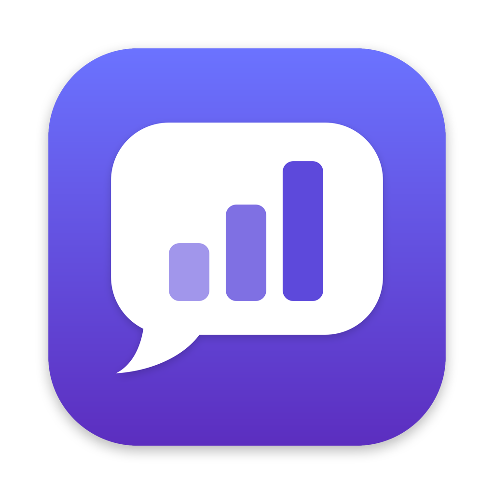
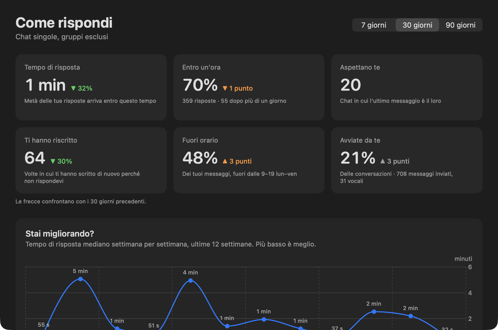

<p align="center">
  
</p>

<h1 align="center">Reply Radar</h1>

<p align="center">
  <b>See how you reply on WhatsApp, and stop leaving people waiting.</b><br>
  A native macOS app that reads the chats already synced on your Mac, privately and read-only,<br>
  and an MCP server that lets Claude Code search them for you.
</p>

<p align="center">
  
  
  
  
</p>

<p align="center">
  
</p>

---

## Why

WhatsApp tells you who wrote to you. It never tells you **how you're doing**:
how long people wait for your answers, who you keep forgetting, how much you write at night,
or which conversations are still open.

Reply Radar answers those questions from the database WhatsApp Desktop already keeps on your Mac.
It doesn't connect to WhatsApp, doesn't add a linked device and can't send anything.

## Features

The window has four tabs: **Summary**, **To do**, **People** and **Habits**.

### Reply statistics (one-to-one chats)

Every number is compared with the previous period of the same length (7, 30 or 90 days), so you can see if you're getting better.

| Metric | What it tells you |
|---|---|
| **Typical reply** | Median time between someone writing to you and your answer. |
| **Slowest 10%** | One reply in ten takes longer than this. A one-minute median can hide replies that take days: this number doesn't let them hide. |
| **Within an hour** | Share of your replies sent within 60 minutes, and how many took more than a day. |
| **Waiting on you** | Chats from the last 12 months where the last message is theirs, with the oldest one named. |
| **Nudges received** | How often someone had to write again because you hadn't answered (a second message after at least an hour of silence). |
| **After hours** | Share of your messages sent outside your working hours (configurable, default Mon–Fri 9–19). |
| **Conversations you start** | Who opens conversations: you or them (a new conversation starts after 8 hours of silence). |
| **Weekly trend** | Median reply time for each of the last 12 weeks: *are you improving?* |
| **Speed by hour of day** | How fast you reply depending on when people write to you. |
| **When you write** | Heatmap of your messages by weekday and hour, with your working hours outlined. |

### Open loops, without AI

- **Waiting for your reply**: who wrote last and has been waiting, and for how long. Covers the last 12 months whatever the period, grouped into *last week*, *1–4 weeks* and *more than a month*, oldest first.
- **Waiting for theirs**: you wrote last and got no answer for more than a day.
- Dismiss a chat with one click. It comes back on its own when a new message arrives.

### People

A sortable table of everyone who wrote in the period or is still waiting for you. For each person it shows the typical reply, the slowest reply, replies that took more than a day, how long they've been waiting now and the message count. Sort by any column, search by name, click a row for the detail view.

### Relationships

- **Who you keep waiting the longest**: your slowest reply in the period, or how long they've been waiting now, whichever is worse.
- **Unbalanced relationships**: you start almost every conversation, or they always do.
- **Contacts going quiet**: people you used to talk to often and haven't heard from in over a month.
- **Contact detail**: you vs. them for messages, reply time, conversations started, nudges, average message length and voice notes. Also shows your five slowest replies, how long they've been waiting and a one-line summary.

### Claude Code integration (MCP)

A separate executable, `reply-radar-mcp`, is bundled in the app and speaks [MCP](https://modelcontextprotocol.io) over stdio.

| Tool | Description |
|---|---|
| `list_chats` | List and filter conversations |
| `search_messages` | Search by text, contact, sender and date range |
| `get_chat_history` | Messages of a chat in chronological order, paginated |
| `get_unread_messages` | Unread chats with their latest received messages |
| `get_media_info` | Attachment metadata: type, file name, size, local path |
| `get_reply_stats` | All the statistics above, compared with the previous period |
| `get_contact_stats` | The relationship with a single contact |
| `get_pending` | Who is waiting for you and who you are waiting for |

Then just ask Claude:

> *"What did Marco tell me about the project?"* · *"Summarize my chat with this client."* ·
> *"What did we agree on last week?"* · *"Who am I keeping waiting?"* ·
> *"Find the message where we set the price."*

## Privacy and security

Privacy is the reason the app exists, so these are hard rules:

- **Read-only.** SQLite is opened with `SQLITE_OPEN_READONLY` and `PRAGMA query_only = 1`. Every query is parameterized.
- **Nothing is sent or changed.** There's no code path that writes to WhatsApp or sends a message.
- **No network.** No telemetry, no analytics, no remote server. Statistics are computed on your Mac.
- **No copies.** The app reads WhatsApp's database directly. It doesn't build its own archive of your messages.
- **No message content in logs.** Errors are logged without texts or names.
- **Untrusted content.** Every MCP response tells the agent that message texts are third-party data, never instructions to follow.
- **You decide what Claude sees.** Group chats can be hidden from the MCP server, and the number of messages per request is capped.

## Requirements

- macOS 26 or later
- [WhatsApp Desktop](https://www.whatsapp.com/download) for Mac, signed in and synced
- Xcode 26 / Swift 6.2 to build

## Install

### Download

Get the latest `Reply-Radar-x.y.z.zip` from [Releases](https://github.com/zxcvbinz/reply-radar/releases). It's a universal build for Apple Silicon and Intel. Unzip it and move the app to Applications.

Builds that aren't notarized are blocked by Gatekeeper the first time you open them. Allow the app once with:

```bash
xattr -dr com.apple.quarantine "/Applications/Reply Radar.app"
```

You can also open it and then confirm in *System Settings › Privacy & Security › Open Anyway*. Each release notes says whether that build is notarized.

### Build from source

```bash
git clone https://github.com/zxcvbinz/reply-radar.git
cd reply-radar
INSTALL=1 ./scripts/build-app.sh      # builds, signs and copies to ~/Applications
open ~/Applications/"Reply Radar.app"
```

`build-app.sh` signs with your first *Apple Development* certificate if you have one, otherwise ad-hoc.
A stable signature matters: with ad-hoc signing macOS forgets the Full Disk Access permission after every rebuild.
Run `UNIVERSAL=1 VERSION=1.0.0 ./scripts/build-app.sh` for a universal build with a version number.

### Releasing

Pushing a tag such as `v0.1.0` runs [the release workflow](.github/workflows/release.yml). It builds a universal app and publishes it on GitHub Releases with its SHA-256.
If the repository has the `MACOS_CERTIFICATE`, `MACOS_CERTIFICATE_PASSWORD`, `APPLE_ID`, `APPLE_TEAM_ID` and `APPLE_APP_PASSWORD` secrets, the app is also signed with Developer ID and notarized.

### First launch

A three-step guided setup:

1. **Full Disk Access.** WhatsApp keeps its chats in a protected folder:
   `~/Library/Group Containers/group.net.whatsapp.WhatsApp.shared/ChatStorage.sqlite`.
   The app opens System Settings and notices when you've granted access.
2. **Database.** Finds the file automatically. You can also choose it by hand.
3. **Check.** Shows the date of the latest message and your most recent conversations, so you can compare them with WhatsApp and confirm everything is in sync.

### Connect Claude Code

*Settings › Claude Code* has a *Copy* button for this command, already filled in with the right path:

```bash
claude mcp add --scope user --transport stdio reply-radar -- \
  "/Applications/Reply Radar.app/Contents/MacOS/reply-radar-mcp"
```

Claude Code starts the server itself; the app doesn't need to be open.
The server inherits the permissions of the terminal that runs Claude Code, so **that terminal needs Full Disk Access too**.

## Settings

Open *Settings* (`⌘,`) to:

- change the database location
- check the Full Disk Access status
- show or hide group chats from Claude, and cap the messages per request
- set your working hours, and optionally count reply times in working hours only (a message received Friday evening and answered Monday at 9 counts as an instant reply)
- restore dismissed chats
- rerun the guided setup

Settings are stored in `~/Library/Application Support/ReplyRadar/settings.json` (readable only by your user), shared by the app and the MCP server. Changes apply immediately.

## How it works

```
WhatsApp Desktop ──writes──▶ ChatStorage.sqlite (+ WAL)
                                   │ read-only
                    ┌──────────────┴──────────────┐
              Reply Radar.app          reply-radar-mcp ◀──stdio── Claude Code
              (SwiftUI dashboard)          (MCP server)
                    └────────── ChatCore ─────────┘
```

| Target | Role |
|---|---|
| `ChatCore` | Database discovery, read-only access via [GRDB](https://github.com/groue/GRDB.swift), queries, statistics, shared settings |
| `reply-radar-mcp` | Minimal MCP server (JSON-RPC over stdio), no SDK dependency |
| `ReplyRadar` | SwiftUI app: guided setup, dashboard, contact detail, settings |

Notes on WhatsApp's database (Core Data on SQLite):

- **WAL, not `immutable=1`.** WhatsApp keeps the database open and writes new messages to the write-ahead log. Opening it read-only and *without* `immutable=1` means every read sees the latest committed messages. `immutable=1` would skip the WAL and miss recent messages.
- **Dates** are seconds since 1 January 2001 (Apple's reference date).
- **Main tables:** `ZWAMESSAGE`, `ZWACHATSESSION` (`ZSESSIONTYPE` 0 = one-to-one, 1 = group), `ZWAGROUPMEMBER`, `ZWAMEDIAITEM`. Attachment paths are relative to the container's `Message/` folder.
- **Schema check.** Every table and column used is verified at startup. If a WhatsApp update changes them, the app reports exactly what is missing instead of failing silently.
- **System messages** (group events, encryption notices) are excluded from all statistics.

### Checking from the terminal

```bash
"$HOME/Applications/Reply Radar.app/Contents/MacOS/ReplyRadar" --check
```

This prints only counts and dates, never message content.

## Limitations

- Only reads what WhatsApp Desktop has synced to this Mac.
- Voice notes aren't transcribed yet, and open loops are detected by *who wrote last*, not by understanding the text.
- Reply statistics cover one-to-one chats; groups are too noisy for this kind of metric.
- Contacts that WhatsApp identifies only by a private ID (`@lid`) show as "Contatto sconosciuto" (unknown contact) when they have no name.
- The interface is in Italian for now.

## Roadmap

- [ ] On-device voice note transcription
- [ ] Optional local AI to find promises and to-dos in messages ("I'll send it tomorrow")
- [ ] Optional full-text index for faster search
- [ ] Menu bar extra with the number of people waiting for you
- [ ] English localization
- [ ] Notarized builds (the release workflow already supports it, it needs a Developer ID certificate)

## Contributing

Issues and pull requests are welcome. Please never attach real message content, names or phone numbers to an issue: describe the shape of the data instead.

```bash
swift build                       # build everything
swift run reply-radar-mcp      # run the MCP server on stdio
swift scripts/make-icon.swift && scripts/make-icns.sh   # regenerate the icon
```

## Research behind the metrics

- Email response analytics measure *time to first response* as a median per person, and support business hours ([Email Meter](https://help.emailmeter.com/en/article/time-before-first-response-zlgtlg/), [Help Scout](https://docs.helpscout.com/article/380-email)).
- Reciprocal ties are more likely to last; unbalanced ones tend to dissolve ([University of Notre Dame study on 7 million phone users](https://provost.nd.edu/news/study-discovers-link-between-cell-phone-usage-and-relationship-strength/)).
- Emotional closeness predicts how quickly people respond to instant messages ([Lee et al., CHI 2019](https://people.cs.nycu.edu.tw/~armuro/pubs/lee-et-al-2019-chi.pdf)).

## Disclaimer

This is an independent open-source project. It is **not affiliated with, endorsed by or sponsored by WhatsApp or Meta**.
"WhatsApp" is a trademark of WhatsApp LLC. The app only reads a database stored on your own computer.
Use it on your own data and respect the privacy of the people you talk to.

## License

[MIT](LICENSE)
